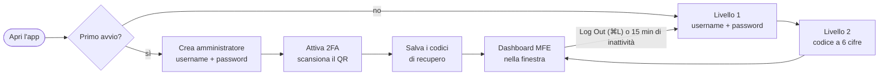
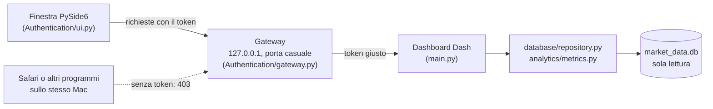

# MFE · Multi-Market Financial Data Analysis Platform (app desktop)

**App desktop in Python per macOS, distribuita come `.dmg`: prima l'accesso a due livelli, poi la dashboard dei mercati dentro la stessa finestra.**

Doppio clic sull'app → username e password → codice a 6 cifre → la finestra mostra la dashboard Multi-Market (asset class, globo, pagine dei mercati con prezzi, rendimenti, rischio e statistiche).

`Python 3.13` · `PySide6 6.12 + Qt WebEngine (Chromium 140)` · `Dash 2.18` · `Plotly 5.24` · `SQLite` · `Argon2id` · `TOTP RFC 6238` · `AES-256-GCM` · `64 test automatici`



Il progetto unisce due repository: **SecureApp** (finestra e sicurezza, ora nel pacchetto `Authentication`) e **Multi-Market-Dashboard** (dashboard e dati). I pacchetti della dashboard sono copiati identici; in `main.py` (ex `app.py`) le poche righe cambiate sono marcate `MERGE`.

---

## 1. Il quadro in 30 secondi

| Pezzo | Cos'è |
|---|---|
| `main.py` | punto di partenza: il codice della dashboard (ex `app.py`) e, in fondo, l'avvio della finestra (ex `main.py` di SecureApp) |
| `Authentication/` | l'ex SecureApp: accesso a due livelli, sessioni, ruoli, finestra (`ui.py`) e il gateway che collega la finestra alla dashboard (`gateway.py`) |
| `analytics/`, `database/`, `providers/`, `assets/`, `config.py`, `CATALOGO.md` | la dashboard, identici al repository originale |
| `style.py` | colori e font della dashboard; in fondo al file, lo stile Qt delle pagine di accesso, costruito con gli stessi colori |
| `self_test.py` | controlli eseguiti sull'app impacchettata (`python main.py --selftest`) |
| `SecureApp.app` | il programma per macOS: **PyInstaller** ci mette dentro Python, Qt, la dashboard e il database, quindi chi lo usa non deve installare nulla |
| `SecureApp-0.1.0.dmg` | l'immagine disco con cui si distribuiscono le app su Mac (creata con **hdiutil**, già incluso in macOS) |

### Come arriva la dashboard nella finestra



La dashboard è un'applicazione web (Dash): prima la aprivi nel browser con `python app.py`. Adesso:

1. dopo il secondo livello, la finestra avvia un piccolo server interno, il **gateway**, che ascolta solo su `127.0.0.1` (il tuo Mac, non la rete) su una porta scelta a caso;
2. il gateway crea un **token di sessione**, un codice casuale di 256 bit, e risponde solo alle richieste che lo contengono;
3. la finestra mostra la dashboard con **Qt WebEngine**, un browser Chromium incorporato, che aggiunge il token a ogni richiesta;
4. Safari, un altro programma o un altro utente del Mac che provasse a collegarsi riceve "403 Access denied". Al logout, allo scadere della sessione o alla chiusura il token viene annullato.

## 2. Prerequisiti (una volta sola)

| Cosa | Perché | Come |
|---|---|---|
| Mac con Apple Silicon (chip M) e macOS 14 o successivo | le librerie Qt di PySide6 6.12 sono per macOS 14+; `cryptography 50.0.2` non ha pacchetti pronti per i Mac Intel | — |
| Xcode Command Line Tools | PyInstaller usa `install_name_tool` e `lipo` | `xcode-select --install` (se usi pyenv o Homebrew li hai già) |
| Python 3.13 **con libreria condivisa** (vanno bene 3.11–3.13, non 3.14) | PyInstaller deve copiare la libreria di Python dentro l'app; `pandas 2.2.3` e `numpy 2.1.3`, le versioni della dashboard, non hanno pacchetti pronti per Python 3.14 | vedi sotto |
| Almeno 3 GB liberi | dipendenze (Qt WebEngine da solo è circa 250 MB da scaricare), cartella di build, app e `.dmg` | — |
| App di autenticazione sul telefono | genera i codici a 6 cifre | **Password** di iPhone (iOS 18+), Google Authenticator, Microsoft Authenticator… |

**Opzione A, consigliata: installer di [python.org](https://www.python.org/downloads/macos/)** (Python 3.13). È già compilato nel modo giusto.

**Opzione B: pyenv.** Di default pyenv compila Python *senza* libreria condivisa e PyInstaller si ferma con `Python library not found`. Reinstalla la versione così:

```bash
env PYTHON_CONFIGURE_OPTS="--enable-framework" pyenv install 3.13   # aggiungi --force se è già installata
pyenv versions                                                       # leggi il numero esatto, es. 3.13.x
```

Lo script di build controlla comunque versione e libreria condivisa e, se qualcosa non va, ti dice cosa fare.

## 3. Provare l'app dal codice (senza creare il .dmg)

```bash
cd ~/Downloads/MFE-SecureApp     # la cartella del progetto
/Library/Frameworks/Python.framework/Versions/3.13/bin/python3 -m venv .venv   # Python di python.org
source .venv/bin/activate
pip install -r requirements-dev.txt
python main.py
```

*Con pyenv, al posto della seconda riga: `pyenv local 3.13.x` (la versione installata con `--enable-framework`) e poi `python -m venv .venv`. Usa la stessa versione sia per lavorare sia per creare il `.dmg`: lo script di build riusa questa `.venv`.*

In VS Code: Cmd+Shift+P → *Python: Select Interpreter* → `.venv`.

**Primo avvio:** crei l'amministratore → con l'app di autenticazione del telefono inquadri il QR → digiti il codice a 6 cifre → salvi gli 8 codici di recupero → si apre la dashboard.
**Avvii successivi:** username e password → codice a 6 cifre → dashboard.
**Uscire:** pulsante **Log Out** in basso a destra, oppure menu Account → Log Out (⌘L).

### Modalità sviluppo: solo la dashboard, nel browser

```bash
python main.py --dev     # poi apri http://127.0.0.1:8050
```

Fa quello che faceva `python app.py`: la dashboard da sola nel browser, con la modalità debug di Dash (si ricarica da sola a ogni modifica del codice), senza login. Serve a lavorare sulla dashboard senza rifare l'accesso con il codice a ogni prova. Funziona **solo dal codice sorgente**: l'app impacchettata ignora `--dev`, quindi chi usa l'`.app` passa sempre dai due livelli di accesso.

## 4. La dashboard

- **Home:** barra laterale con le asset class (Equity, Fixed Income, Derivatives, Commodities, Foreign Exchange), menu a tendina regione → mercato e pulsante **Esplora sul globo**.
- **Pagina di un mercato** (per esempio Borsa Italiana): percorso cliccabile Dashboard / Equity / Europa / Borsa Italiana, ricerca della security, periodo, frequenza e quattro schede: Prezzi, Rendimenti, Rischio, Statistiche di mercato.
- In fondo alla finestra: chi è collegato e con quale ruolo, e il pulsante Log Out.

`main.py` legge **regione e coordinate direttamente dal database**: le 29 voci compaiono nei filtri della barra laterale. I luoghi fisici hanno una posizione sul globo; i mercati non localizzati, come FX OTC e categorie obbligazionarie globali, si esplorano con i due menu a tendina. I marketplace nella stessa città possono sovrapporsi sul globo: i menu restano il metodo più preciso per distinguerli.

Cose da sapere:

- **Internet** serve per il globo (Plotly scarica la mappa del mondo da `cdn.plot.ly`) e per i font IBM Plex (Google Fonts). Senza internet tutto il resto funziona: il globo resta vuoto e i testi usano un font di riserva. Era così anche nella versione da browser.
- I grafici con più di 1.000 punti (per esempio vari anni di prezzi giornalieri) Plotly li disegna con **WebGL**, cioè con la scheda grafica. Tutti i Mac con Apple Silicon la hanno.
- Le immagini salvate dai grafici (icona della macchina fotografica) vanno nella cartella Download: la barra in basso mostra per qualche secondo dove.

## 5. Dati di mercato: aggiornare il database

Il database incluso è `database/market_data.db` del repository della dashboard. Stato verificato il 24/11/2026:

| | |
|---|---|
| Mercati nel catalogo | 29 (3 ancora senza strumenti: `COMM_LME`, `DER_CBOE_OPTIONS`, `DER_EUREX`) |
| Strumenti | 51, inclusi i benchmark |
| Prezzi | 150.541 righe, dal 01/01/2015 al 22/11/2026 |
| Dividendi | 1.279 righe |
| Fondamentali | 0 righe: per questo il riquadro "Fondamentali" non compare mai |
| Ultimo aggiornamento | 22/11/2026 10:09, fonte Yahoo |

Il README originale della dashboard spiegava come passare a 29 mercati (quali file sostituire): qui è già fatto. I numeri che citava (54.501 prezzi, 141 dividendi) si riferivano a una versione precedente del database.

I comandi seguenti si lanciano dalla cartella del progetto, con la `.venv` attiva.

1. **Proteggi i tuoi dati.** Prima di ogni aggiornamento fai una copia di `database/market_data.db`.
2. **Aggiorna il catalogo** (serve solo con un database creato da una versione precedente):
   ```bash
   python -m database.populate --catalog-only
   ```
   Crea le eventuali colonne geografiche mancanti e aggiorna mercati e strumenti, senza scaricare dati, senza cancellare gli storici e senza `REPLACE` sulle chiavi esterne. Puoi ripeterlo: il risultato è sempre lo stesso.
3. **Verifica:**
   ```bash
   python -m database.verify
   ```
   Vedrai le 29 voci con il numero di strumenti e di ticker con prezzi. **Un mercato nel catalogo non significa che il suo storico sia stato scaricato.**
4. **Scarica i dati mancanti** (facoltativo), senza riscaricare le serie già presenti:
   ```bash
   python -m database.populate --new-only --start 2020-01-01
   python -m database.populate --market EQ_US_NASDAQ --new-only --start 2022-01-01   # una sola borsa
   ```
   Altri codici: `EQ_TOKYO`, `FI_TREASURY`, `COMM_ICE`, `DER_CME`; l'elenco completo è in `CATALOGO.md`. Yahoo non garantisce che ogni ticker sia disponibile: se non risponde, il programma registra il fallimento nei metadata senza inventare dati. Alcuni titoli hanno una storia più corta di quella richiesta. **Non usare `--mock` per dati reali:** produce serie sintetiche, adatte solo alle prove.
5. **Porta i nuovi dati nell'app.** L'`.app` contiene una copia del database fatta al momento della build, aperta in sola lettura: dopo un aggiornamento rifai `bash build_mac.sh`. Con `python main.py` invece si legge direttamente il database del progetto.

## 6. Creare l'app e il .dmg

```bash
bash build_mac.sh
# con un Python specifico:
PYTHON=/Library/Frameworks/Python.framework/Versions/3.13/bin/python3 bash build_mac.sh
```

Lo script si ferma con un messaggio chiaro al primo problema:

0. controlla che esista `database/market_data.db`;
1. controlla Python (versione 3.11–3.13 e libreria condivisa) e gli Xcode Command Line Tools;
2. crea `.venv` e installa le dipendenze con le versioni fissate;
3. esegue i test;
4. crea `dist/SecureApp.app` con PyInstaller (`app.spec`, che aggiunge il logo, il database e i file JavaScript di `dash_mantine_components`);
5. verifica la firma ad-hoc e lancia l'app impacchettata con `--selftest`: Argon2id, AES-GCM, TOTP e QR; pagine e script della dashboard; gateway (403 senza token); Qt WebEngine;
6. crea `dist/SecureApp-0.1.0.dmg` con `hdiutil` e ne verifica il checksum.

L'app pesa circa 0,8 GB, quasi tutti per il motore web Chromium (misurato con la stessa ricetta su Linux; PyInstaller tiene solo la parte per il processore del Mac su cui crei l'app).

## 7. Usare il .dmg

1. Doppio clic su `SecureApp-0.1.0.dmg`: si apre una finestra del Finder con SecureApp e la scorciatoia **Applicazioni**.
2. Trascina SecureApp su Applicazioni (oppure doppio clic per provarla direttamente dal disco).
3. Espelli il disco "SecureApp".
4. Apri SecureApp da Applicazioni o Launchpad: la finestra si apre sul login e, dopo i due livelli, sulla dashboard.

### Se la dai ad altre persone

- **Gatekeeper.** Sul tuo Mac l'app si apre senza avvisi perché l'hai creata tu. Su un altro Mac, scaricata da internet, viene bloccata perché non è firmata con un certificato Apple Developer ID né notarizzata. Chi la riceve fa: Impostazioni di Sistema → Privacy e sicurezza → sezione Sicurezza → **Apri comunque** (il pulsante resta per circa un'ora dopo il tentativo di apertura) → password del Mac. Per eliminare l'avviso serve l'Apple Developer Program: firma con `codesign_identity` in `app.spec` e notarizzazione con `xcrun notarytool`.
- **Processore.** L'app viene compilata per il processore del Mac su cui la crei (Apple Silicon su un Mac M) e funziona sui Mac dello stesso tipo.

## 8. Sicurezza: requisito → implementazione

| Requisito della specifica | Implementazione | Dove |
|---|---|---|
| **Primo livello**: username e password | Stesso messaggio d'errore per utente inesistente e password sbagliata, e stesso tempo di risposta (verifica fittizia), così non si scopre quali utenti esistono | `Authentication/auth.py` → `login_password` |
| **Secondo livello**: OTP / 2FA | TOTP (RFC 6238): codice a 6 cifre ogni 30 s da un'app di autenticazione, attivato con QR code; tolleranza ±30 s; ogni codice vale una sola volta (anti-replay); 8 codici di recupero monouso se perdi il telefono | `verify_otp`, `verify_recovery_code` |
| **Secure password storage** | Argon2id (64 MiB, t=3, p=4, sopra il minimo OWASP di 19 MiB, t=2, p=1) con salt casuale: la password non viene mai salvata. Regole NIST SP 800-63B-4: almeno 12 caratteri, nessun obbligo di maiuscole o simboli, rifiuto delle password comuni | `security.py`, `policy.py` |
| | Il segreto TOTP è cifrato con AES-256-GCM con una chiave derivata dalla password (Argon2id, salt separato): chi copia il database degli utenti non può leggerlo | `confirm_enrollment` |
| Protezione da tentativi ripetuti | 5 errori consecutivi (password o codice) → account bloccato 15 minuti; il blocco è salvato su disco, quindi riavviare l'app non lo aggira | `_register_failure` |
| **Session management** | Token casuale da 256 bit; uscita automatica dopo 15 minuti di inattività e comunque dopo 8 ore (dentro i limiti OWASP ASVS livello 3: 15 min / 12 h); clic, tasti e scroll dentro la dashboard contano come attività; Log Out con ⌘L; nessuna sessione salvata su disco, quindi a ogni avvio si rifà il login | `check_session`, `touch`, `logout`; `ui.py` → `eventFilter` |
| **Access controls** | Ruoli `admin` / `user` / `viewer` → permessi; decoratore `@requires("permesso")`; il ruolo è riletto dal database a ogni chiamata; tutto ciò che non è esplicitamente permesso è negato. Aprire la dashboard richiede il permesso `data.read` (oggi lo hanno tutti e tre i ruoli); creare utenti richiede `users.manage` (solo admin) | `ROLE_PERMISSIONS`, `requires`, `open_dashboard` |
| **Accesso alla dashboard** | Il gateway ascolta solo su `127.0.0.1`, su una porta casuale, e solo dopo il primo accesso; risponde solo con il token della sessione (256 bit, confronto a tempo costante), che viaggia nell'intestazione delle richieste e mai nell'indirizzo; senza token: 403. Token annullato al logout, alla scadenza e alla chiusura | `gateway.py`; `ui.py` → `_enter_dashboard`, `logout` |
| Browser incorporato | Profilo privato (cookie e cache solo in memoria, nulla su disco); la finestra non naviga verso altri siti (un link esterno non si apre; mappa del globo e font arrivano comunque da internet); nessun menu contestuale | `ui.py` → `DashboardView`, `_GuardedPage` |
| Tracciabilità | Tabella `audit_log`: accessi, errori, blocchi, accessi negati, aperture della dashboard (mai password, codici o segreti) | `storage.py` |
| Dati locali | Utenti in `~/Library/Application Support/SecureApp/`, cartella leggibile solo da te (700), database 600; query SQL parametrizzate (niente SQL injection). Il database dei mercati è aperto in sola lettura | `Authentication/config.py`, `storage.py`, `database/connection.py` |

Tutti i parametri (timeout, tentativi, lunghezza minima, durata del blocco) sono in `Authentication/config.py`. Per dati finanziari valuta un'inattività di 5 minuti: l'OWASP Session Management Cheat Sheet cita 2–5 minuti per le applicazioni ad alto valore.

## 9. Creare altri utenti

Non c'è un "Sign up": gli utenti li crea solo un amministratore, da Terminale (stessa cartella e `.venv` del punto 3):

```bash
python -m Authentication.add_user
```

1. Accedi come amministratore con password e codice a 6 cifre, come nell'app.
2. Scegli username, password provvisoria e ruolo del nuovo utente (`admin`, `user` o `viewer`).
3. Comunica la password provvisoria alla persona in modo riservato.
4. Al primo accesso il nuovo utente inserisce username e password e poi scansiona il **proprio** QR code con il suo telefono.

Lo script chiama `AuthService.create_user`, protetta dal permesso `users.manage`: con un account `user` o `viewer` risponde "Your role does not allow this action.". Usa lo stesso database dell'app, quindi vale anche per l'app installata.

## 10. Dove modificare il codice

- **La dashboard** (layout, callback, grafici): `main.py`; i calcoli in `analytics/metrics.py`, le query in `database/repository.py`. I parametri della dashboard (percorso del database, mercati, tasso risk-free…) sono nel `config.py` della cartella principale.
- **Colori e font:** `style.py`. Lo stile delle pagine di accesso (`QT_PALETTE`, `QT_STYLESHEET`, in fondo al file) è costruito da `COLORS`, quindi cambiando un colore lì cambiano sia la dashboard sia la finestra.
- **Finestra e accesso:** `Authentication/ui.py`; regole di sicurezza in `Authentication/auth.py` e `Authentication/config.py`.
- **Due file `config.py`, due ruoli diversi:** `config.py` (cartella principale) è della dashboard; `Authentication/config.py` contiene nome dell'app, cartella dei dati e parametri di sicurezza.
- **Le operazioni da proteggere** vanno in `AuthService`, dietro `@requires(...)`, come `open_dashboard`:

```python
# Authentication/auth.py, dentro AuthService
@requires("data.write")
def save_note(self, session: Session, text: str) -> None:
    ...  # ci arrivi solo con una sessione valida e un ruolo che ha "data.write"
```

- **Nome dell'app**: è rimasto `SecureApp` (`APP_NAME` e `BUNDLE_ID` in `Authentication/config.py`, letti anche da `app.spec` e `build_mac.sh`). Se lo cambi, cambia anche la cartella dei dati: utenti e 2FA ripartono da zero.
- **Icona**: crea un file `.icns` e indicalo in `app.spec` (`icon=...`).
- **Lingua**: i testi delle pagine di accesso sono in inglese, come la specifica; si cambiano in `Authentication/ui.py`.

## 11. Test

```bash
pytest                                            # 63 test; quello sul motore web è saltato
SECUREAPP_WEBENGINE_TESTS=1 pytest tests/test_webengine.py   # facoltativo: avvia il vero Chromium
SCREENSHOT_DIR=shots pytest tests/test_ui.py      # salva anche le schermate in shots/
```

I test coprono, per l'accesso: flusso completo della finestra; password mai salvate in chiaro; vettori ufficiali RFC 6238; blocco dopo 5 errori; anti-replay; tolleranza dell'orologio; scadenza dei passaggi e della sessione; codici di recupero monouso; ruoli e permessi; creazione utenti riservata all'admin; cambio password con 2FA che continua a funzionare.

Per la dashboard e il collegamento: pagine e script serviti dal gateway; 403 senza token, con un token sbagliato o messo nell'indirizzo; token nuovo a ogni sessione e annullato al logout e alla chiusura; nessuna dashboard prima dell'accesso o senza il permesso `data.read`; callback reali sul database (globo, pagina di Borsa Italiana, tutte le schede di analisi, periodo incompleto); `--dev` ignorato nell'app impacchettata. Il test facoltativo apre la dashboard nel vero Chromium dentro la finestra, apre una pagina di mercato, controlla che un secondo browser senza token riceva "Access denied" e che dopo il logout la pagina sia vuota.

## 12. Limiti

### Finanziari e metodologici (dalla dashboard)

- **Fixed Income**: IEF, TLT, IEGA.AS, LQD, HYG sono ETF usati come *proxy*; non rappresentano tutte le emissioni obbligazionarie. I loro rendimenti sono rendimenti di ETF, non rendimenti a scadenza dei bond sottostanti.
- **Derivatives**: contratti futures generici Yahoo, non una term structure completa per scadenza. Eurex e Cboe Options sono già nel catalogo ma richiedono integrazione dati specialistica prima di mostrare prezzi.
- **Commodities**: LME è censita ma i prezzi specifici LME non sono garantiti da Yahoo. Futures agricoli rappresentati da contratti CBOT.
- **FX**: le coppie valutarie sono segmenti del mercato OTC globale, non borse geograficamente localizzate.
- Le coordinate Euronext indicano Parigi come localizzazione illustrativa: Euronext è un gruppo di sedi di negoziazione in più paesi.
- **Non confondere la presenza di una borsa nel database con la copertura integrale dei titoli quotati su quella borsa.** Gli strumenti sono esempi, non il listino completo.

### Tecnici

- L'app contiene una copia del database fissata al momento della build (punto 5).
- Globo e font richiedono internet (punto 4).
- Le versioni fissate valgono per Mac con Apple Silicon e Python 3.11–3.13.
- Verificato in un ambiente Linux, non su un Mac: tutti i test, il test facoltativo con il vero Chromium, la build con PyInstaller e il `--selftest` dell'app impacchettata, e che tutte le dipendenze abbiano pacchetti pronti per macOS Apple Silicon. La build `.app`/`.dmg` su macOS la verifica `build_mac.sh` sul tuo Mac (passi 3 e 5).

## 13. Compatibilità del database

La struttura `prices`, `dividends`, `fundamentals`, `metadata` è invariata. Sono aggiunti solo 5 campi nella tabella `markets`: `region`, `city`, `latitude`, `longitude`, `kind`. La migrazione usa `ALTER TABLE ADD COLUMN` solo quando il campo manca. Tutti i dati esistenti restano invariati.

## 14. Problemi comuni

| Sintomo | Soluzione |
|---|---|
| `Python library not found` durante la build | Python senza libreria condivisa: vedi il punto 2 |
| La build dice che `.venv` è stata creata con un Python non adatto | `rm -rf .venv`, poi rilancia `bash build_mac.sh` con il Python giusto |
| `pip install` prova a compilare `pandas` o `numpy` | stai usando Python 3.14: usa 3.13 |
| `xcrun: error: invalid active developer path` | `xcode-select --install` |
| Doppio clic sull'app e non succede nulla | Avviala da Terminale per leggere l'errore: `dist/SecureApp.app/Contents/MacOS/SecureApp`. Log: `~/Library/Application Support/SecureApp/app.log` |
| Il codice a 6 cifre viene sempre rifiutato | Attiva data e ora automatiche su iPhone e sul Mac |
| "Too many failed attempts" | Aspetta 15 minuti |
| Il globo è vuoto | Manca internet: la mappa arriva da `cdn.plot.ly` |
| Un grafico mostra "WebGL is not supported" | La scheda grafica non è disponibile (succede in alcune macchine virtuali o desktop remoti): apri l'app direttamente sul Mac |
| Copiando l'indirizzo della dashboard in Safari compare "Access denied" | È voluto: la dashboard si apre solo nella finestra, dopo l'accesso (per lavorarci nel browser c'è `python main.py --dev`) |
| La build si ferma: `database/market_data.db is missing` | Crea il database (punto 5) o copialo dal repository della dashboard |
| Ricominciare da zero (cancella utenti e 2FA) | `rm -rf ~/Library/Application\ Support/SecureApp` |

## 15. Struttura

```
MFE-SecureApp/
├── main.py               dashboard (ex app.py) + avvio della finestra (ex main.py di SecureApp)
├── self_test.py          controllo dell'app impacchettata (--selftest)
├── style.py              colori e font: dashboard + pagine di accesso
├── config.py             parametri della dashboard (database, mercati, tasso risk-free…)
├── CATALOGO.md           codici dei 29 mercati
├── Authentication/       ex SecureApp
│   ├── config.py         nome app, cartella dei dati, parametri di sicurezza
│   ├── policy.py         regole per username e password (NIST)
│   ├── security.py       Argon2id, AES-256-GCM, TOTP, codici di recupero
│   ├── storage.py        database degli utenti (SQLite)
│   ├── auth.py           autenticazione, sessioni, ruoli e permessi
│   ├── gateway.py        server locale con token che serve la dashboard alla finestra
│   ├── ui.py             finestra, pagine di accesso e dashboard (PySide6 + Qt WebEngine)
│   └── add_user.py       crea altri utenti da Terminale (solo admin)
├── analytics/            calcoli quantitativi (metrics.py)
├── database/             database dei mercati: connessione, schema, query, populate, verify
├── providers/            fonti dei dati (Yahoo, mock)
├── assets/               logo MFE
├── tests/                test automatici (pytest)
├── esempi/               piccoli programmi per imparare a rifare la parte di accesso, un passo alla volta
├── app.spec              ricetta PyInstaller per l'.app
├── build_mac.sh          .app + .dmg in un comando
└── requirements*.txt     dipendenze con versioni fissate (unione di SecureApp e dashboard)
```

In `requirements.txt` tre pacchetti della dashboard (`bcrypt`, `gspread`, `google-auth`) sono commentati perché nessun file del progetto li usa: se ti servono, togli il `#`.

## 16. Tutorial e fonti

**Dal codice Python all'app `.app` e al `.dmg`**
- [Packaging PySide6 applications into a macOS app with PyInstaller](https://www.pythonguis.com/tutorials/packaging-pyside6-applications-pyinstaller-macos-dmg/) (pythonguis.com)
- [Qt for Python & PyInstaller](https://doc.qt.io/qtforpython-6.11/deployment/deployment-pyinstaller.html) (documentazione ufficiale Qt)
- [Using PyInstaller](https://pyinstaller.org/en/stable/usage.html) (documentazione ufficiale)

**Autenticazione a due livelli**
- [How to Implement 2FA in Python](https://thepythoncode.com/article/implement-2fa-in-python) (The Python Code)
- [PyOTP](https://pyauth.github.io/pyotp/)
- [OWASP Password Storage Cheat Sheet](https://cheatsheetseries.owasp.org/cheatsheets/Password_Storage_Cheat_Sheet.html)
- [OWASP Session Management Cheat Sheet](https://cheatsheetseries.owasp.org/cheatsheets/Session_Management_Cheat_Sheet.html)
- [NIST SP 800-63B-4: Authenticators](https://pages.nist.gov/800-63-4/sp800-63b/authenticators)

**Dashboard nella finestra**
- [Dash](https://dash.plotly.com/) (documentazione ufficiale)
- [Qt WebEngine Separate Release](https://www.qt.io/blog/qt-webengine-will-release-separate) (Qt): da Qt 6.12 il motore web è un pacchetto a parte, per questo `requirements.txt` ha `PySide6-WebEngine`
- [Qt WebEngine releases](https://doc.qt.io/qtwebengine/qwe-releases.html) (Qt): perché la versione è 6.140 (Chromium 140)
- [High Performance Visualization in Python](https://plotly.com/python/performance/) (Plotly): quando Plotly usa WebGL

**macOS**
- [Aprire un'app di uno sviluppatore non identificato](https://support.apple.com/guide/mac-help/open-a-mac-app-from-an-unidentified-developer-mh40616/mac) (Apple)
